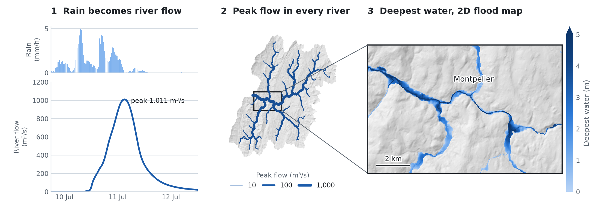
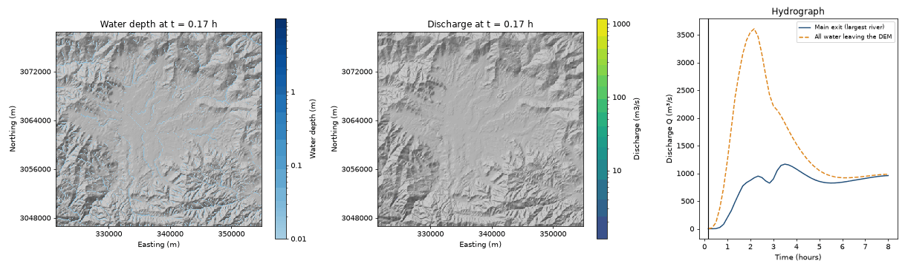
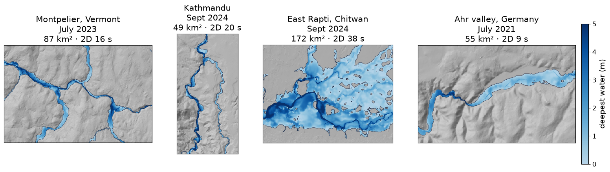

# MRRpy

[](https://pypi.org/project/MRRpy/)
[](https://pypi.org/project/MRRpy/)
[](https://github.com/SauravBhattarai19/MRRpy/actions/workflows/tests.yml)
[](https://mrrpy.readthedocs.io)
[](LICENSE)

**Rainfall–runoff, flood routing and flood maps for any basin on Earth, from a DEM and a storm.**

<picture>
  <source media="(prefers-color-scheme: dark)" srcset="https://raw.githubusercontent.com/SauravBhattarai19/MRRpy/main/docsite/assets/img/hero_dark.png">
  
</picture>

<sub>The July 2023 flood at Montpelier, Vermont, from global data only (FABDEM
terrain, NASA IMERG rain, global soils and land cover) with no calibration: the
1,318 km² basin routed at 90 m in about 2 minutes and the 87 km² 2D flood map at
30 m in 16 seconds, on a 32-core workstation. How it compares with the gauge and the USGS high-water
marks: [Example 13](https://mrrpy.readthedocs.io/en/latest/examples/flood-2d-town/).</sub>

MRRpy, the **M**ulti-**M**echanism **R**unoff and **R**outing model, is a
distributed, physics-based flood model in Python. Give it an elevation model and
a storm. It traces the drainage network, works out how much rain runs off the
soil, routes the water through every grid cell and river channel, and returns the
flood hydrograph, flow at any point you name, flood depth and extent maps, and a
check that no water was lost. It runs offline with your own data, or fetches
what is missing (elevation, satellite or weather-model rain, soil, land cover),
so even an ungauged basin can be modelled in minutes.

## What's new in 1.0

- **Flood maps.** Depth and extent maps from the routed flow, either `hand`
  (the whole basin in seconds) or `2d`, a 2D flood simulation of a town or
  valley, with finer terrain than the model grid if you have it.
- **Forecasts.** Rain from the world's weather models (ECMWF, GFS, ICON, …)
  through [Open-Meteo](https://open-meteo.com), for past storms or up to 16 days
  ahead. No account needed.
- **Restart files.** Save the model state and continue from it later, for
  forecasts that run again every few hours.

Full list in the [changelog](CHANGELOG.md).

## Installation

```bash
pip install "MRRpy[all]"       # recommended: Earth Engine + Jupyter form + USGS data
pip install "MRRpy[all,gpu]"   # + NVIDIA GPU acceleration (needs CUDA 12.x)
pip install MRRpy              # minimal: Python API and command line
```

QGIS users: download `MRRpy_plugin.zip` from the
[latest release](https://github.com/SauravBhattarai19/MRRpy/releases/latest) and
install it with *Plugins → Manage and Install Plugins → Install from ZIP*;
the zip includes a copy of MRRpy.

## Quick start

```python
from MRRpy import Config, run_pipeline

cfg = Config(DEM_PATH="dem.tif", OUTPUT_DIR="results/",
             OUTPUT_POINT=(27.632, 85.293),   # (lat, lon) of the outlet
             TARGET_CRS_EPSG="EPSG:32645")    # a projection in metres (UTM zone)
run_pipeline(cfg)                             # → results/hydrograph.csv
```

Add flood maps of a town or valley:

```python
cfg = Config(DEM_PATH="dem.tif", OUTPUT_DIR="results/",
             OUTPUT_POINT=(27.632, 85.293), TARGET_CRS_EPSG="EPSG:32645",
             INUNDATION_MAP=True, INUNDATION_METHOD="2d",
             INUNDATION_AREA=(85.276, 27.595, 85.325, 27.683))  # lon/lat box
run_pipeline(cfg)                             # → results/inundation/flood_depth_max.tif
```

Or without writing code:

```bash
MRRpy wizard                    # answer a few plain questions → run.yaml
MRRpy run -c run.yaml
```

In Jupyter, `MRRpy.ConfigForm()` is a step-by-step form with a map for picking
the outlet and the flood-map area. `MRRpy init-config -o run.yaml` writes a
commented settings file, and `MRRpy explain <SETTING>` explains any setting.

## What it does

| Step | Options |
|---|---|
| **Terrain** | Your DEM, or one downloaded for you (FABDEM, Copernicus, NASADEM, ALOS, MERIT, USGS 3DEP, …). Pit filling, D8 flow directions, watershed delineation, or the whole DEM with no outlet. |
| **Rain** | Rain gauges (Thiessen or IDW), NASA IMERG satellite rain, Open-Meteo weather models and forecasts, or one uniform rate. Optional rain/snow split by elevation. |
| **Runoff** | SCS Curve Number, or physical mechanisms in any combination: Green–Ampt infiltration (with soil drying between storms), saturated source areas (VSA), impervious cities. Soil and land cover from global maps or your own rasters. |
| **Routing** | Kinematic wave, Muskingum–Cunge, or a semi-implicit diffusion wave (backwater, flat valleys), through every grid cell and a river channel sized from the 2-year flood. Water entering from upstream can be added as a hydrograph. |
| **Flood maps** | HAND for the whole basin, or a 2D flood simulation of a chosen area, on the model's DEM or a finer one (e.g. lidar). Depth, extent, speed, time of the peak, duration, animations. |
| **Outputs** | Hydrograph, flow and depth at named points, maps and animations of depth and flow, peak GeoTIFFs, an always-on water-balance check, restart files. |
| **Speed** | NumPy and Numba on the CPU, or CuPy on an NVIDIA GPU, with automatic fallback to the CPU. |
| **Interfaces** | Python API, a command line with a question-and-answer wizard, a Jupyter form and a QGIS plugin, all driven by one `Config`. |

Every Earth Engine option also works offline with your own files.

## Gallery



*A 2-hour storm over the whole Kathmandu valley at 90 m. Left: water depth.
Middle: river flow, drawn wider where it is larger. Right: flow leaving the valley.
([Example 10](https://mrrpy.readthedocs.io/en/latest/examples/whole-dem/))*



*The same settings at four places, from global data and with no calibration;
each 2D flood map took 9–38 seconds on a workstation.
([Example 13](https://mrrpy.readthedocs.io/en/latest/examples/flood-2d-town/))*

## Learn more

- **Documentation:** [mrrpy.readthedocs.io](https://mrrpy.readthedocs.io): getting
  started, a user manual that explains every setting, worked examples and the API.
- **Interactive course:** [the science behind MRRpy](https://sauravbhattarai19.github.io/MRRpy/),
  step by step.
- **Questions and bugs:** [GitHub issues](https://github.com/SauravBhattarai19/MRRpy/issues).
  Contributions are welcome; see [CONTRIBUTING.md](CONTRIBUTING.md).

## Citing

If you use MRRpy in your work, please cite it; GitHub's *Cite this repository*
button (from [CITATION.cff](CITATION.cff)) gives the reference.

## License

[MIT](LICENSE) © Saurav Bhattarai.
