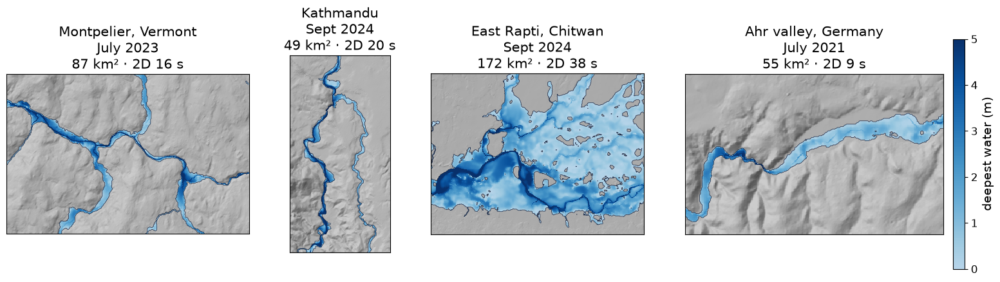

# 13 A flood map for your town (2D)

**Goal:** a 2D flood simulation for one town, from satellite rain, with only
the town's coordinates and the dates of the storm; then how big to make the
area and how long it takes, from five places.

**You need:** an Earth Engine sign-in and project ([setup](../manual/earth-engine.md))
and `pip install "MRRpy[gee]"`. In Jupyter, the same steps are in
`notebooks/flood_maps_2d.ipynb`.

**Settings used:** [[INUNDATION_MAP]], [[INUNDATION_METHOD]], [[INUNDATION_AREA]],
[[INUNDATION_DEM]], [[PRECIP_METHOD]], [[EVENT_START_UTC]], [[RUNOFF_SOURCE]],
[[MANNINGS_N_SOURCE]], [[DEM_BOUNDS_WGS84]], [[OUTPUT_POINT]].

The example is Montpelier, Vermont, in the flood of 10–11 July 2023.

## The steps

1. **The basin.** A box around the river basin, for the terrain download, and
   the outlet: a point on the river at or just below the town. MRRpy finds the
   basin above it.
2. **The storm.** The dates, for satellite rain (NASA IMERG), or rain gauges, or
   a design storm.
3. **The area for the flood map.** A box around the town (see
   [how big](#how-big-should-the-area-be) below).
4. **Run.** MRRpy routes the river flow over the whole basin at 90 m, then
   simulates the flood in 2D over the box, on FABDEM at 30 m, with the routed
   rivers flowing in.
5. **Read** the maps, and the warnings in the log: if the flood reached an edge
   of the box, make the box larger there and redraw.

## Set it up

=== "Notebook form"

    1. **Terrain**: *Download a DEM for an area*, `fabdem`, *Download
       resolution* `90`. Press **Pick the outlet or download area on a map**:
       click the river just below the town for the outlet, then, with *A
       rectangle sets:* **Area to download**, draw a rectangle around the basin
       with the square tool.
    2. **Coordinate system**: **Use the outlet's UTM zone**.
    3. **Precipitation**: *IMERG satellite rain*, event start `2023-07-09 00:00`,
       simulation length `96` hours.
    4. **Runoff**: `scs_cn`.
    5. **Routing**: `diffusive_implicit`; roughness from land cover (`lulc`).
    6. **Outputs and run**: tick *Flood depth and extent maps*, *How to spread
       the water* `2d`. Back on the map, choose *A rectangle sets:* **Area for
       the flood maps** and draw the box around the town. Then **Run the model**.

=== "Config file + CLI"

    ```yaml
    DEM_PATH: ''
    DEM_SOURCE: fabdem
    DEM_SCALE_M: 90.0
    DEM_BOUNDS_WGS84: [-72.85, 43.95, -72.15, 44.62]
    OUTPUT_POINT: [44.27504, -72.65924]
    GEE_PROJECT: ee-yourname
    OUTPUT_DIR: results/montpelier/
    PRECIP_METHOD: imerg_thiessen
    EVENT_START_UTC: '2023-07-09 00:00'
    TOTAL_SIMULATION_TIME_HOURS: 96.0
    RUNOFF_SOURCE: scs_cn
    MANNINGS_N_SOURCE: lulc
    ROUTING_SCHEME: diffusive_implicit
    INUNDATION_MAP: true
    INUNDATION_METHOD: 2d
    INUNDATION_AREA: [-72.6527, 44.2201, -72.5122, 44.2847]
    ```

    ```bash
    MRRpy run -c montpelier.yaml
    # another box, your own LiDAR or the other method, without routing again:
    MRRpy run -c montpelier.yaml --stages inundation
    ```

=== "Python"

    ```python
    from MRRpy import Config, run_pipeline, plot_inundation, animate_inundation

    cfg = Config(
        DEM_PATH="", DEM_SOURCE="fabdem", DEM_SCALE_M=90,
        DEM_BOUNDS_WGS84=(-72.85, 43.95, -72.15, 44.62),        # the basin
        OUTPUT_POINT=(44.27504, -72.65924),                     # the outlet, below the town
        GEE_PROJECT="ee-yourname", OUTPUT_DIR="results/montpelier/",
        PRECIP_METHOD="imerg_thiessen",
        EVENT_START_UTC="2023-07-09 00:00", TOTAL_SIMULATION_TIME_HOURS=96,
        RUNOFF_SOURCE="scs_cn", MANNINGS_N_SOURCE="lulc",
        ROUTING_SCHEME="diffusive_implicit",
        INUNDATION_MAP=True, INUNDATION_METHOD="2d",
        INUNDATION_AREA=(-72.6527, 44.2201, -72.5122, 44.2847),  # the town
    )
    out = run_pipeline(cfg)
    plot_inundation(out)                                         # deepest water
    animate_inundation(out, out_path="results/montpelier/flood.gif")

    cfg.INUNDATION_AREA = (-72.62, 44.24, -72.57, 44.27)         # just downtown,
    out2 = run_pipeline(cfg, stages=["inundation"])              # no routing again
    ```

=== "QGIS plugin"

    1. Tab **1 · DEM & Watershed**: download FABDEM at 90 m for the basin box and
       delineate the watershed at the outlet.
    2. Tab **2 · Precipitation**: IMERG from 2023-07-09 00:00 UTC. Tab **3 ·
       Runoff**: SCS curve numbers.
    3. Tab **4 · Routing**: `diffusive_implicit`, 96 h; in *Flood Depth and
       Extent Maps* tick *Make flood depth and extent maps*, choose *Flood
       simulation over one area (2D)* and type the box in *Map only this area*:
       `-72.6527, 44.2201, -72.5122, 44.2847`.
    4. **Run**. On tab **5 · Results**, **Load Flood Maps** adds the depth and
       the flooded area.

## How big should the area be?

- **The river runs through the box**, and its edges cross the valley rather
  than run along it.
- **Leave half a kilometre to a kilometre of valley beyond the town**, upstream
  and downstream. Water leaves the box wherever the ground slopes out of it, but
  in a big flood it backs up towards the edge a river enters through. If the run
  says the flood reached an edge, extend the box there.
- **The outlet** (`OUTPUT_POINT`) sits at or below the box, so every river in
  the box is routed.
- **Size:** 20–100 km² at 30 m runs in seconds; up to about 500 km² is fine on a
  workstation. The limit is 5 million cells (about 4,500 km² at 30 m, 500 km²
  at 10 m).

Measured on a 32-core workstation, four days of storm, implicit routing at
90 m, the 2D on FABDEM at 30 m:

| Place | Basin | Routing | Area for the 2D | 2D simulation |
|---|---|---|---|---|
| Ahr valley, Germany | 854 km² (105,000 cells) | 59 s | 55 km² (61,000 cells) | 9 s |
| Kathmandu, Nepal | 606 km² (75,000 cells) | 117 s | 49 km² (55,000 cells) | 20 s |
| Montpelier, Vermont | 1,318 km² (163,000 cells) | 139 s | 87 km² (96,000 cells) | 16 s |
| East Rapti, Chitwan | 2,303 km² (284,000 cells) | 655 s | 172 km² (191,000 cells) | 38 s |
| Pearl River at Jackson, Mississippi | (a gauged inflow) | – | 520 km² (575,000 cells) | 5 min for 15 days |

The Earth Engine downloads (terrain, rain, curve numbers, land cover) add under
a minute on a first run and are kept for reruns. On a laptop expect a few times
longer.

## Five places



*The same settings at four places: FABDEM, IMERG rain, global curve numbers,
land-cover roughness, no calibration.*

| Place | Flood | River flow, model vs gauge | Flood map vs observations |
|---|---|---|---|
| Montpelier, Vermont | July 2023 | 1,011 vs 654 m³/s | all 40 USGS high-water marks inside the flood; levels 1.25 m high |
| Kathmandu, Nepal | Sept 2024 | 1,875 vs about 1,020 m³/s (the record ends near the crest) | 90 % of the flood traces seen by Sentinel-2 |
| East Rapti, Chitwan | Sept 2024 | no gauge record at hand | much wider than Sentinel-1 saw a day later |
| Ahr valley, Germany | July 2021 | gauge destroyed by the flood | none used |

What the places show:

- **The map follows the flows.** Where gauges exist, satellite rain gave
  1.5–1.8 times the peak flow, and the maps flood too much accordingly. Driven
  by the measured flows, the same 2D maps were within 0.4 m of the high-water
  marks on LiDAR and 1 m on FABDEM
  ([6.3](../manual/outputs.md#63-flood-depth-and-extent-maps)). With rain gauges
  or a gauged inflow, use them.
- **Flat valleys need large areas.** In the flat Chitwan valley the flood
  spreads over kilometres; confined valleys hold it in a band.
- **A big river routed in from a gauge into a small model area** (the Pearl,
  with [Example 8](inflow-hydrograph.md)'s inflow points) travels too slowly:
  below an inflow point the channel is sized by the local drainage area. For a
  big river, route its whole basin.

## Other options to try

| Change | Setting | See |
|---|---|---|
| your own LiDAR for the flood map | `INUNDATION_DEM: file`, `INUNDATION_DEM_PATH: lidar.tif` | [6.3](../manual/outputs.md#63-flood-depth-and-extent-maps) |
| quick maps for every river instead | `INUNDATION_METHOD: hand` | [Example 12](flood-maps.md) |
| rain gauges instead of satellite rain | `PRECIP_METHOD: thiessen` | [Example 6](rain-gauges.md) |
| another box, without routing again | `MRRpy run -c montpelier.yaml --stages inundation` | [6.6](../manual/outputs.md#66-running) |
