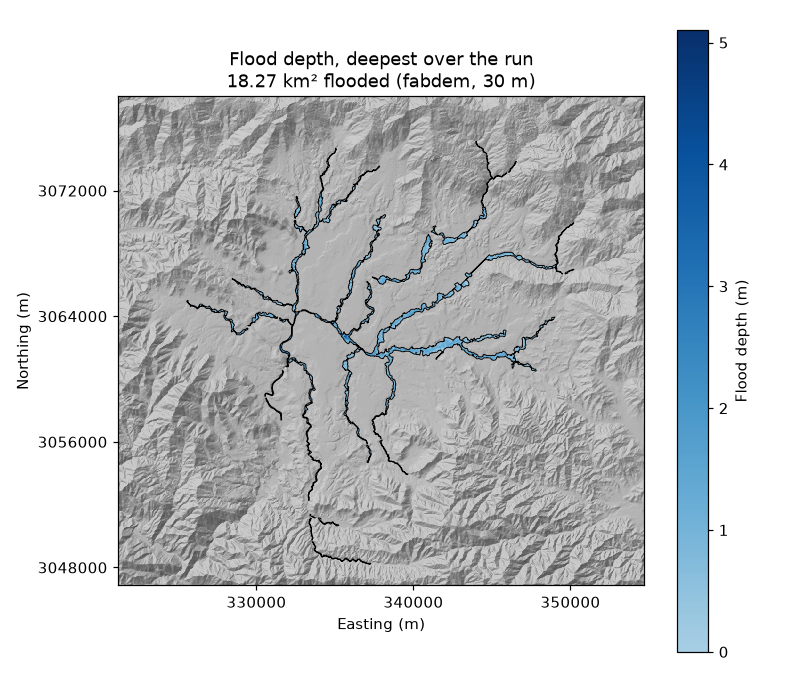
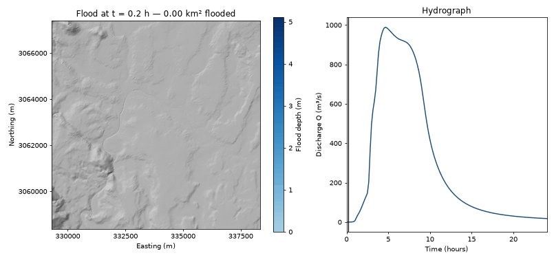
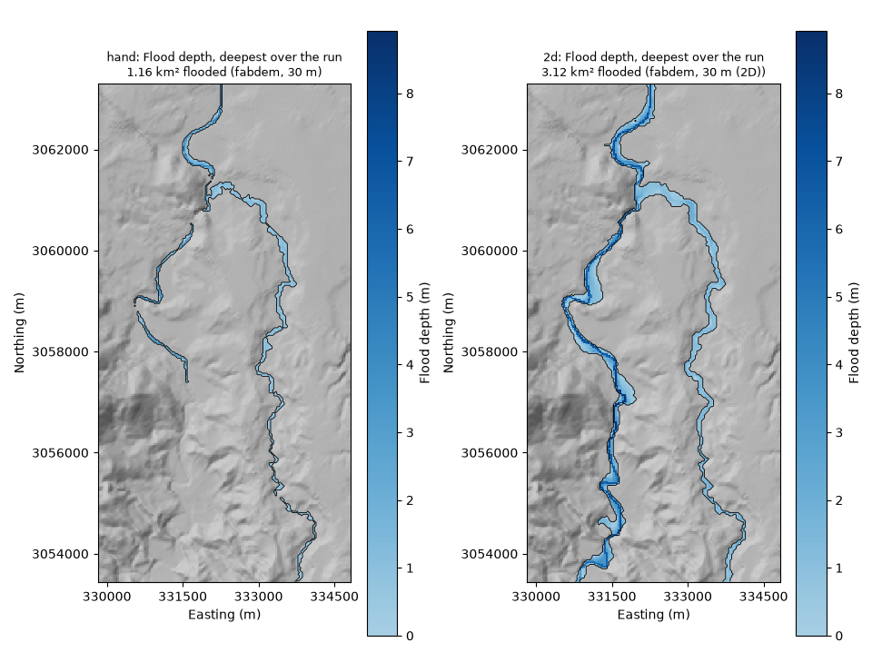
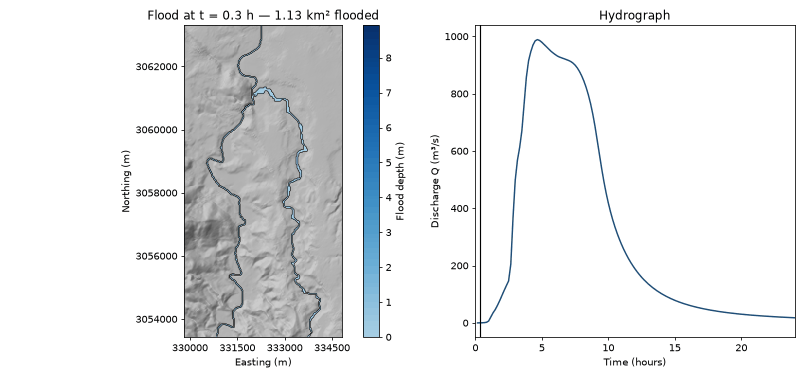

# 12 Flood depth and extent maps

**Goal:** see how far the rivers spread in a flood: quick maps of flood depth
and extent for the whole basin, then a 2D flood simulation for one valley, drawn
at 30 m while the model runs at 90 m.

**You need:** an Earth Engine sign-in and project ([setup](../manual/earth-engine.md))
and `pip install "MRRpy[gee]"`, for the DEM and its finer copy. With your own
DEM instead, see *Other options to try*.

**Settings used:** [[INUNDATION_MAP]], [[INUNDATION_METHOD]], [[INUNDATION_DEM]],
[[INUNDATION_AREA]], [[INUNDATION_ANIMATION]], [[DEM_SOURCE]], [[DEM_SCALE_M]],
[[CHANNEL_QBF_M3S]].

The storm: 15 mm/h for 3 hours on the Bagmati above Khokana, all of it running
off (`RUNOFF_SOURCE: none`). The terrain is FABDEM (bare earth: buildings and
trees removed) averaged to 90 m, and the river channels are sized for the
2-year flood with the Nepal formula (`wecs_nepal`). With `INUNDATION_DEM: auto`
the flood maps use FABDEM at its own 30 m.

## Set it up

=== "Notebook form"

    1. **Terrain**: *Download a DEM for an area*, area `85.1, 27.5, 85.6, 27.9`,
       *DEM dataset* `fabdem`, *Download resolution* `90`. Outlet
       `27.632222, 85.293333`, results folder `results/flood_maps/`. Connect to
       Earth Engine.
    2. **Coordinate system**: **Use the outlet's UTM zone**.
    3. **Precipitation**: *Design storm*, `15` mm/h for `3` h.
    4. **Runoff**: `none`.
    5. **Routing**: `diffusive_implicit`, simulation length `24`. Under *River
       channels*, *Bankfull flow*: formula `wecs_nepal`.
    6. **Outputs and run**: tick *Flood depth and extent maps*; *How to spread
       the water* `hand`; *Elevation data for the flood maps* `auto`; keep
       *Flood animation (GIF)* ticked. Then **Run the model**.
    7. For the 2D simulation: back on **Outputs and run**, choose *How to spread
       the water* `2d`, *Area for the flood maps* `85.276, 27.595, 85.325,
       27.683`, and run again (the maps are redrawn from the saved flows).

=== "Config file + CLI"

    ```yaml
    DEM_PATH: ''
    DEM_BOUNDS_WGS84: [85.1, 27.5, 85.6, 27.9]
    DEM_SOURCE: fabdem
    DEM_SCALE_M: 90.0
    GEE_PROJECT: ee-yourname
    OUTPUT_POINT: [27.632222, 85.293333]
    TARGET_CRS_EPSG: EPSG:32645
    OUTPUT_DIR: results/flood_maps/
    RAIN_INTENSITY_MM_HR: 15.0
    RAIN_DURATION_HOURS: 3.0
    RUNOFF_SOURCE: none
    ROUTING_SCHEME: diffusive_implicit
    TOTAL_SIMULATION_TIME_HOURS: 24.0
    CHANNEL_QBF_M3S: wecs_nepal
    MANNINGS_N: 0.06
    MANNINGS_N_CHANNEL: 0.035
    INUNDATION_MAP: true
    INUNDATION_METHOD: hand
    INUNDATION_DEM: auto
    ```

    ```bash
    MRRpy run -c flood.yaml
    ```

    Then the 2D simulation for one valley, from the saved flows (no routing
    again): set these in `flood.yaml` and run only the `inundation` stage.

    ```yaml
    INUNDATION_METHOD: 2d
    INUNDATION_AREA: [85.276, 27.595, 85.325, 27.683]
    ```

    ```bash
    MRRpy run -c flood.yaml --stages inundation
    ```

=== "Python"

    ```python
    from MRRpy import Config, run_pipeline, plot_inundation, animate_inundation

    cfg = Config(
        DEM_PATH="", DEM_BOUNDS_WGS84=(85.1, 27.5, 85.6, 27.9),
        DEM_SOURCE="fabdem", DEM_SCALE_M=90.0, GEE_PROJECT="ee-yourname",
        OUTPUT_POINT=(27.632222, 85.293333), TARGET_CRS_EPSG="EPSG:32645",
        OUTPUT_DIR="results/flood_maps/",
        RAIN_INTENSITY_MM_HR=15.0, RAIN_DURATION_HOURS=3.0, RUNOFF_SOURCE="none",
        ROUTING_SCHEME="diffusive_implicit", TOTAL_SIMULATION_TIME_HOURS=24.0,
        CHANNEL_QBF_M3S="wecs_nepal", MANNINGS_N=0.06, MANNINGS_N_CHANNEL=0.035,
        INUNDATION_MAP=True,                 # flood depth and extent maps
        INUNDATION_METHOD="hand",            # quick, every river
        INUNDATION_DEM="auto",               # FABDEM at 30 m for the maps
    )
    out = run_pipeline(cfg)

    plot_inundation(out)                                         # the whole basin
    plot_inundation(out, area=(85.27, 27.64, 85.36, 27.72))     # central Kathmandu
    animate_inundation(out, area=(85.27, 27.64, 85.36, 27.72),
                       out_path="kathmandu_flood.gif")

    # 2D flood simulation for the Chobhar–Khokana valley, from the saved flows
    cfg.INUNDATION_METHOD = "2d"
    cfg.INUNDATION_AREA = (85.276, 27.595, 85.325, 27.683)
    out2d = run_pipeline(cfg, stages=["inundation"])
    plot_inundation(out2d)
    ```

=== "QGIS plugin"

    1. Tab **1 · DEM & Watershed**: download FABDEM at 90 m for the area above
       and delineate the watershed at the outlet.
    2. Tab **2 · Precipitation**: *Uniform*, 15 mm/h for 3 h. Tab **3 ·
       Runoff**: *None*.
    3. Tab **4 · Routing**: `diffusive_implicit`, 24 h; in *Flood Depth and
       Extent Maps* tick *Make flood depth and extent maps*, keep *How to
       spread the water* on *Quick* and *Elevation data for the maps* on `auto`.
    4. **Run**. On tab **5 · Results**, **Load Flood Maps** adds the depth and
       the flooded area; **Open Flood Animation** plays the GIF.
    5. For the 2D simulation: choose *Flood simulation over one area (2D)*,
       type `85.276, 27.595, 85.325, 27.683` in *Map only this area*, and run
       again.

## Results

{ width="560" }

*`plot_inundation(out)`: the deepest water each place reached, outlined in
black, over the relief.*



*`animate_inundation(out, area=…)`: the frames follow the largest flood; the
title gives the time and the area under water in view.*

- The outlet peaks at **989 m³/s**, 4.7 hours after the rain started: about
  1.9 times the bankfull flow of 522 m³/s that the channel is sized for.
- With `hand` on FABDEM at 30 m, **18.3 km²** are under water at some time
  (the rivers included), at most **5.1 m** deep; it takes 2 seconds. Drawn on
  the 90 m model grid (`INUNDATION_DEM: model_grid`) the same flood covers
  20.8 km²: the coarser cells blur the river banks.
- The water spreads where the banks are low, along the side rivers of the
  valley floor.
- The run writes the maps, `flood_animation.gif`, `reaches.csv` and
  `rating_curves.csv` to `results/flood_maps/inundation/`
  ([what each file holds](../manual/outputs.md#63-flood-depth-and-extent-maps)).
  The routing took 33 seconds; the 30 m maps a few seconds more, after the
  one-time download.

How the `hand` maps are made: every cell is linked to the river it drains to,
and each 1 km river reach gets a rating curve from the land beside it. The
reach's peak flow gives its water level, and everything lower is flooded. On the
30 m DEM each river takes the flow of the routed 90 m river nearby that drains
the same area; here 100 % of the 30 m river cells in the basin found one. See
[6.3](../manual/outputs.md#63-flood-depth-and-extent-maps).

### The 2D simulation of one valley

{ width="680" }

*Left: the `hand` map of the box. Right: `INUNDATION_METHOD: 2d` over the
same box, the Bagmati from Kathmandu (top) and the Nakhu (bottom right) flowing
in. The `hand` map stops at the model's outlet, the Khokana gauge; the 2D
simulation covers the whole box.*



- The box is 49 km², 167 × 329 cells of 30 m. Two rivers flow in: the Bagmati
  (522 km², peak 887 m³/s) and the Nakhu (44 km², peak 185 m³/s); the land
  inside the box adds its own runoff.
- MRRpy simulates the whole 24 hours (the largest flood entering the box)
  after filling the rivers: **5 seconds**, with no water lost or created
  (balance error about 10⁻¹⁴).
- **3.1 km²** of the box is under water at some time, at most **8.9 m** deep,
  0.7 km below the Khokana gauge, where FABDEM narrows the valley.
- `inflows.csv` lists the rivers flowing in; `flood_velocity_max.tif` maps the
  fastest flow (here up to 7 m/s, in the narrow reaches).

!!! note "Checked against a real gauge"
    At Khokana the Department of Hydrology and Meteorology's rating rises 2.2 m
    between 100 and 500 m³/s. The `hand` rating curve there (no calibration)
    rises about 1.5 m: two thirds of it, because it assumes the flow is not
    held back from downstream. The 2D simulation of the September 2024 flood
    backs the water up behind the narrowing in FABDEM 0.7 km below the gauge
    and rises about twice as much as the rating. With a global DEM, check
    narrow places against the ground (LiDAR, a survey or a site visit).

## Other options to try

| Change | Setting | See |
|---|---|---|
| only one town or valley (faster on a fine DEM) | `INUNDATION_AREA: [85.27, 27.64, 85.36, 27.72]` | [6.3](../manual/outputs.md#63-flood-depth-and-extent-maps) |
| the 2D flood simulation for that area | `INUNDATION_METHOD: 2d` | [6.3](../manual/outputs.md#63-flood-depth-and-extent-maps) |
| your own fine DEM, e.g. LiDAR | `INUNDATION_DEM: file`, `INUNDATION_DEM_PATH: lidar.tif` | [6.3](../manual/outputs.md#63-flood-depth-and-extent-maps) |
| maps on the model grid, no download | `INUNDATION_DEM: model_grid` | [6.3](../manual/outputs.md#63-flood-depth-and-extent-maps) |
| a real storm | `PRECIP_METHOD: imerg_thiessen` | [Example 7](satellite-storm.md) |
| redraw the maps without routing | `MRRpy run -c flood.yaml --stages inundation` | [6.6](../manual/outputs.md#66-running) |
