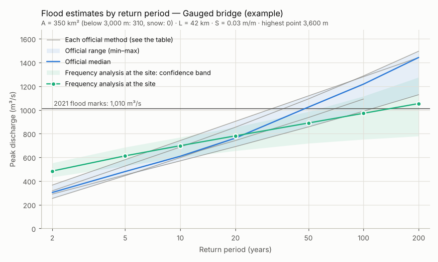

# MRRpy-Nepal

**Nepal's official flood-estimation methods next to a physics-based flood model,
in one tool.**

MRRpy-Nepal measures a catchment from its DEM, runs the methods that Nepali
design manuals name (WECS/DHM, DHM 2004, MHSP, Modified Dickens, specific
discharge, Rational, frequency analysis, the catchment area ratio), and sets
beside them a flood simulated by the MRRpy physics model from a design storm
built the Nepali way. You get one table, the range of the official methods,
where the physics flood falls in it, what to watch out for, a chart and a
report. Monthly flows, the e-flow and low flows are on their own tab.

[Quick start](nepal/index.md){ .md-button .md-button--primary }
[Use cases](nepal/use-cases.md){ .md-button }
[All formulas](nepal/methods.md){ .md-button }



*The chart of a study: five official regional formulas (grey, their range
shaded and the median in blue), a GEV fit to 20 years of gauge record with its
90 % band (green) and the 2021 flood marks (line). Example inputs: the gauged
bridge site of [use case 4](nepal/use-cases.md#bridge), with every regional
formula ticked.*

## What it does

<div class="grid cards" markdown>

-   :material-terrain:{ .lg .middle } __Measures the catchment__

    ---

    Area, area below 3,000 m and 5,000 m, snow area, longest flow path and its
    slope, from the DEM, the same way every time.
    [Catchment numbers](nepal/catchment.md)

-   :material-book-open-variant:{ .lg .middle } __Runs the official methods__

    ---

    Every regional formula with its validity check, interpolation and
    compendium caveats, each explained with a worked example.
    [Regional formulas](nepal/regional-formulas.md)

-   :material-weather-pouring:{ .lg .middle } __Uses your rainfall__

    ---

    The Rational method (Kirpich, Mononobe) and the T-year 24-hour rainfall,
    typed or fitted to a DHM station record.
    [Rainfall methods](nepal/rainfall-methods.md)

-   :material-chart-bell-curve:{ .lg .middle } __Uses your gauges__

    ---

    Gumbel, Log-Pearson III and GEV with bootstrap confidence bands; a donor
    gauge by area ratio; flood marks by slope–area.
    [Frequency analysis](nepal/frequency.md)

-   :material-waves:{ .lg .middle } __Simulates the flood__

    ---

    A Mononobe design storm through SCS-CN runoff and kinematic routing on the
    DEM: peak, timing, volume and maps, with climate factors.
    [Design floods](nepal/design-floods.md)

-   :material-scale-balance:{ .lg .middle } __Compares and reports__

    ---

    The official range, where each method sits in it, warnings, a chart and a
    Markdown report for the design file.
    [Reading the results](nepal/results.md)

-   :material-calendar-month:{ .lg .middle } __Monthly and low flows__

    ---

    MIP 1982, WECS/DHM and MHSP monthly flows, the low-flow rule, the e-flow,
    80 % dependable flow and 7Q10.
    [Monthly flows](nepal/monthly-flows.md)

-   :material-clipboard-check:{ .lg .middle } __Follows your manual__

    ---

    Choose DoWRI, DoLIDAR, DoED, WECS, DoR, AEPC or NEA and the structure; the
    methods and return periods are ticked for you.
    [Manuals and structures](nepal/guidelines.md)

</div>

## Try it

```bash
pip install "MRRpy[notebook]"
```

=== "Notebook form"

    ```python
    from MRRpy.nepal import NepalForm
    NepalForm()        # 1 Site · 2 Methods · 3 Results · Monthly and low flows
    ```

=== "Command line"

    ```bash
    MRRpy nepal estimate --area 65 --agency dowri_2019 --structure weir \
        --length-km 15 --slope 0.015 --C 0.45 --rain24 2=120 50=230 100=250
    MRRpy nepal methods          # every method, manual and structure
    ```

=== "Python"

    ```python
    from MRRpy.nepal import NepalStudy

    study = NepalStudy.from_numbers(65, flow_length_km=15, flow_path_slope=0.015,
                                    agency="dowri_2019", structure="weir",
                                    inputs={"runoff_coefficient": 0.45,
                                            "rain_24h": {2: 120, 50: 230, 100: 250}})
    result = study.run()
    result.table, result.envelope, result.plot()
    ```

=== "QGIS plugin"

    **MRRpy_plugin** → Processing Toolbox → *3. Nepal flood estimates (official
    methods)* and *4. Nepal design storm*.
    [Install the plugin](getting-started/interfaces.md#qgis-plugin).

## Why both the formulas and the physics?

The national formulas were fitted mostly to large mountain rivers. For the
small Terai and Chure streams where many structures are built, the area below
3,000 m is the whole catchment, so the formulas use area alone: no rainfall,
slope or soil. They disagree by a factor of 3 or more (compendium §6). The
physics model adds exactly what they lack, and reviewers still see the official
numbers they expect. MRRpy-Nepal shows both, side by side, and says how far
apart they are.

## Built on MRRpy

MRRpy-Nepal is a layer around **MRRpy** (Multi-Mechanism Runoff and Routing), a
distributed physics-based rainfall–runoff and flood-routing model for any basin.
The physics model is unchanged. Everything in its
[user manual](manual/index.md) (other runoff methods, routing schemes,
satellite rain, flood maps) works in a Nepal study through a model settings
file. Start with [the MRRpy model](mrrpy.md) and its
[quickstart](getting-started/quickstart.md).

!!! note "Sources and responsibility"
    Every coefficient comes from the compendium *Nepal Flood Estimation
    Methods*. Where it says a value still has to be checked against the original
    report, the method's notes say so too. The agency presets show which methods
    a manual names; they are a starting point, not a statement that a design
    complies with that manual. The responsibility for a design flood stays with
    the engineer.
