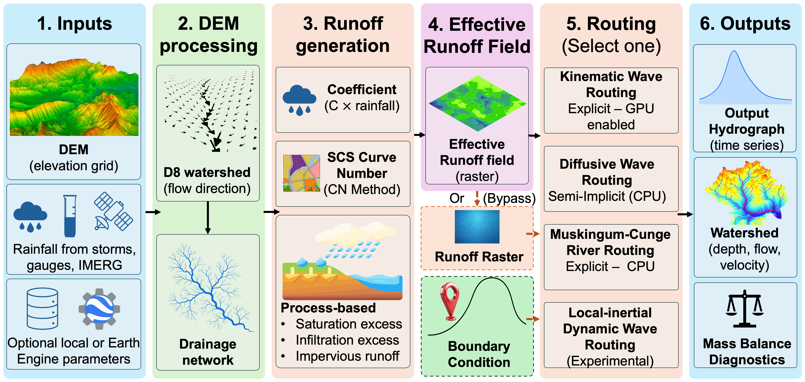

# Summary

`MRRpy` is an open-source, modular Python hydrological model for distributed
rainfall–runoff simulation and channel flood routing, built to be changed
and extended. From a digital elevation model (DEM), it delineates a D8
drainage network, builds a precipitation field (uniform, gauged, or
satellite), generates runoff (runoff coefficient, Curve Number, or
process-based Green–Ampt infiltration-excess, variable-source-area
saturation-excess, and impervious mechanisms), and routes it (kinematic
wave, Muskingum–Cunge, or a semi-implicit diffusive wave solved exactly on
the D8 tree).

Each stage hands the next a single field, so any rainfall
source feeds any runoff method and any runoff method drives any routing
scheme; a new method in one stage works at once with every method in the
others, and an automated test matrix checks every runoff–routing
combination for mass conservation. One configuration drives the model from a Python API, a
command-line wizard, a Jupyter form, or a QGIS plugin, and upstream inflow
hydrographs, virtual gauges, and per-cell depth and velocity maps are
available on request. With Google Earth Engine supplying rainfall, soil,
and terrain data, an ungauged basin can be set up and analysed quickly.
`MRRpy` installs from PyPI and is documented at
<https://mrrpy.readthedocs.io>.

# Statement of need

Isolating one modeling decision in a flood study is harder than it should
be. Comparing two runoff methods with routing held fixed, two routing schemes
with runoff held fixed, or gauge against satellite rainfall with both held
fixed usually means joining separate research codes or rebuilding the
runoff-to-routing-to-diagnostics plumbing by hand, and the inputs, boundary
handling, mass accounting, and outputs are easily made inconsistent. The same
barrier faces method developers: testing a new infiltration model needs a
router, and testing a new router needs runoff. `MRRpy` factors precipitation,
runoff generation, and routing into independent stages behind one
configuration, so a comparison is a change of setting, and a new method
inherits the rest of the model, its inputs, outputs, and tests. The same
structure is meant to grow: further processes, such as groundwater recharge
or sediment transport, can be added as new components that reuse the
existing terrain, forcing, and routing, and the authors are developing such
extensions.

Many runs are as easy as one: a sweep or full factorial over rainfall
source, runoff method, routing scheme, and channel geometry is a loop over
configuration values, with one comparable ledger row per run and optional
GPU acceleration.

`MRRpy` serves hydrologists running quick analyses, method comparisons, or
calibration sweeps; developers testing a new component against established
ones; researchers routing a gauge record, reservoir release, or another
model's discharge through its boundary-inflow interface; and students
learning each method from readable code and an interactive textbook
(<https://sauravbhattarai19.github.io/MRRpy/>).

# State of the field

`pysheds` [@bartos2020] and `pyflwdir` [@eilander2021] are strong Python
libraries for D8 terrain analysis but stop at flow directions and
delineation; `MRRpy` uses either and continues through runoff, routing, and
diagnostics. Landlab [@barnhart2020] is a general Earth-surface-dynamics
framework from whose components a comparable model could be assembled, with
more effort. GSSHA [@downer2004] is a mature, physically based distributed
hydrologic model under continued development [@pradhan2019water;
@pradhan2024], while LISFLOOD-FP [@bates2010; @dealmeida2012] provides
advanced floodplain hydraulic modeling capabilities. Complementing these
established modeling systems, `MRRpy` emphasizes a modular Python-based
architecture that facilitates the integration, interchange, and evaluation of
runoff-generation and routing methods through standardized interfaces. We are
not aware of an open tool that lets a user combine any rainfall source, runoff
method, and routing scheme on the same grid, add a new method that immediately
works with all the others, and check every combination for mass conservation;
for detailed two-dimensional floodplain hydraulics, a dedicated inundation
model remains the right tool.

# Software design

\autoref{fig:architecture} shows the pipeline. One configuration object
drives the same pipeline from every interface. A single parameter catalogue
generates the wizard, the notebook form, and the manual's settings tables.

{width="100%"}

**Terrain and parameters.** DEM processing conditions the terrain (by default
least-cost carving [@yamazaki2012] with `pyflwdir` [@wang2006]; `pysheds`
[@ocallaghan1984] with filling remains available), computes D8 flow
directions, and delineates the catchment above an outlet or keeps the whole
DEM; a missing DEM is downloaded from Earth Engine. Soil and
land-cover parameters come from local inputs or Earth Engine
[@gorelick2017], including ESA WorldCover [@zanaga2022], SoilGrids
[@poggio2021], and HiHydroSoil [@simons2020].

**Precipitation** is its own stage, returning a rain-rate field per cell at
any time behind one interface. Sources are a uniform hyetograph, rain gauges
interpolated by Thiessen polygons or inverse-distance weighting, and IMERG
satellite rainfall [@huffman2020] downloaded from Earth Engine and treated
as a dense pseudo-gauge network with the same interpolators.

**Runoff generation** is a registry of interchangeable modes behind a
two-step interface (compute runoff, then update soil state): direct rainfall, a
runoff coefficient, SCS Curve Number [@chow1988; @jaafar2019], a prescribed
raster, and a process-based mode. The process-based mode is itself a second
registry of mechanisms composed per cell without counting rainfall twice;
the built-in ones are Green–Ampt infiltration excess [@green1911;
@rawls1983], saturation excess, and impervious shedding, with soil recovery
between storms following EPA SWMM 5 [@rossman2016]. Saturation excess uses
the variable-source-area theory of @pradhan2010, which needs only an initial
soil-moisture deficit, here from the satellite-based SERVES method
[@pradhan2019serves]; developed earlier as a stand-alone theory, it is
applied here for distributed simulation alongside standard Green–Ampt. A new
method is a class registered with a decorator.

**Routing** schemes are likewise registered. Kinematic wave,
variable-parameter Muskingum–Cunge [@cunge1969; @ponce1978], and a
semi-implicit diffusive wave are supported; an explicit diffusive wave is
deprecated and a local-inertial scheme [@dealmeida2012] is experimental.
Channel cells carry a sub-grid channel [@neal2012] sized to a bankfull
discharge that is user-given or estimated globally [@linke2019;
@andreadis2013].
The semi-implicit scheme applies the classical direct elimination for
tree-structured systems to the whole D8 grid, giving an exact implicit solve
in linear time without the explicit Courant limit, using Numba [@lam2015] or
SciPy [@virtanen2020]. Kinematic and explicit diffusive routing, runoff,
and precipitation can run on a CuPy GPU backend. A discharge hydrograph can
be injected at any channel point, with or without rainfall.

**Outputs** are common to every combination: an outlet hydrograph, one
ledger row per run (rainfall, boundary inflow, outflow, storage, closure
error), and optionally virtual gauges, a per-cell field archive, and runoff
split by mechanism, with one-call plotting, animation, and map export.

**Testing.** Because every method meets the same interface, the model is
tested as a whole rather than one method at a time. For every change to the
main branch, continuous integration (Python 3.9–3.12) runs each supported
routing scheme with each runoff method and every subset of the physical
mechanisms, with soil recovery on and off, over two storms separated by a
dry spell; each run must close its mass balance to $10^{-6}$ and never
produce more runoff than rain, and GPU results are compared with CPU where
available. A new component added to this matrix is checked against every
existing one. Analytic benchmarks and a verification script for the
semi-implicit solve (against dense and sparse solvers and the Hayami
solution) cover the numerics.

# Research impact statement

`MRRpy` is designed as a foundation for research rather than a single
application, and its impact rests on five capabilities.

First, it makes ungauged basins workable. Terrain, satellite rainfall, soil,
and land cover can all come from Earth Engine, so a first model needs no
local data, and running it across the available satellite products and a
range of runoff and routing assumptions gives a bounded estimate quickly
enough to support early warning. Where gauge records, field surveys, or
local rasters exist, they replace the global inputs through the same
configuration, so a model can start ungauged and improve as data arrive.

Second, it supports analysis at every scale of effort: a single event,
continuous multi-year simulation with soil recovery between storms, or
hundreds of scenarios in one sweep, every run on one comparable ledger.
Rainfall and upstream inflow can drive the same run, and the saved depth,
velocity, and discharge fields show the flood at any location.

Third, it rests on physically based processes and established
numerical schemes with verified mass conservation, so its results can be explained.
Initial simulations of observed Bagmati River floods at Khokana,
Nepal, driven by government rain gauges and automatic weather stations
installed by SmartPhones4Water, agree encouragingly with observed discharge
and, for the September 2024 flood, with the timing and shape of observed
water levels at most of ten Kathmandu Valley stations.

Fourth, it serves teaching and learning. The textbook, the worked examples,
and readable code let students learn each method, apply it to their own
basin, and estimate floods, and its four interfaces open it to programmers
and GIS practitioners alike.

Finally, it is a beginning. Follow-up papers will present new
runoff-generation physics built on the mechanism registry and an
application to ungauged basins validated against observed floods. Further
processes, a stable local-inertial scheme, and a two-dimensional
shallow-water model that zooms into selected areas to map inundation from
the routed flows are in development.

# AI usage disclosure

Anthropic's Claude Code CLI (Claude Sonnet 4.6, Opus 4.6, Opus 4.8, Sonnet 5,
Fable 5, and Opus 5.5) was used for code implementation, refactoring, test
scaffolding, documentation, and drafting and revising this manuscript. All AI-assisted
code and text were reviewed, tested, and edited by the human authors, who
are responsible for the correctness of the software, the validity of the
reported results, and the content of this paper.

# Acknowledgements

`MRRpy` is built on the open-source scientific-Python and geospatial
ecosystem, including NumPy [@harris2020], SciPy [@virtanen2020], `rasterio`,
GeoPandas, `pysheds`, and `pyflwdir`, and we thank their developers and
maintainers.

This research was supported in part by an appointment to the Department of
Defense (DOD) Research Participation Program administered by the Oak Ridge
Institute for Science and Education (ORISE) through an interagency agreement
between the U.S. Department of Energy (DOE) and the DOD. ORISE is managed by
ORAU under DOE contract number DE-SC0014664. All opinions expressed in this
paper are the authors' and do not necessarily reflect the policies and views of
DOD, DOE, or ORAU/ORISE.

This research was also supported by the U.S. Army Engineer Research and
Development Center, Coastal and Hydraulics Laboratory (ERDC–CHL), through its
Earth System Hydrology research initiative, with technical support provided
under the ERDC–CHL professional services contract with Taylor–Woolpert, LLC.

`MRRpy`, an open-source hydrologic modeling software package, was developed
through research collaboration between the U.S. Army Engineer Research and
Development Center, Coastal and Hydraulics Laboratory (ERDC–CHL), and the
Hydrology Laboratory at Jackson State University (JSU).

# References
